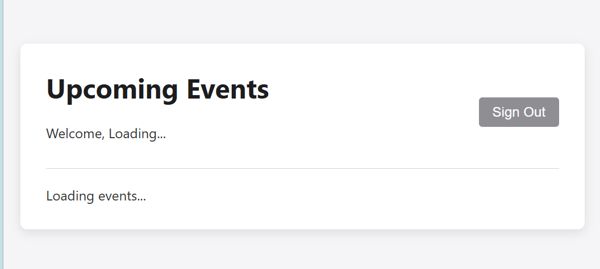
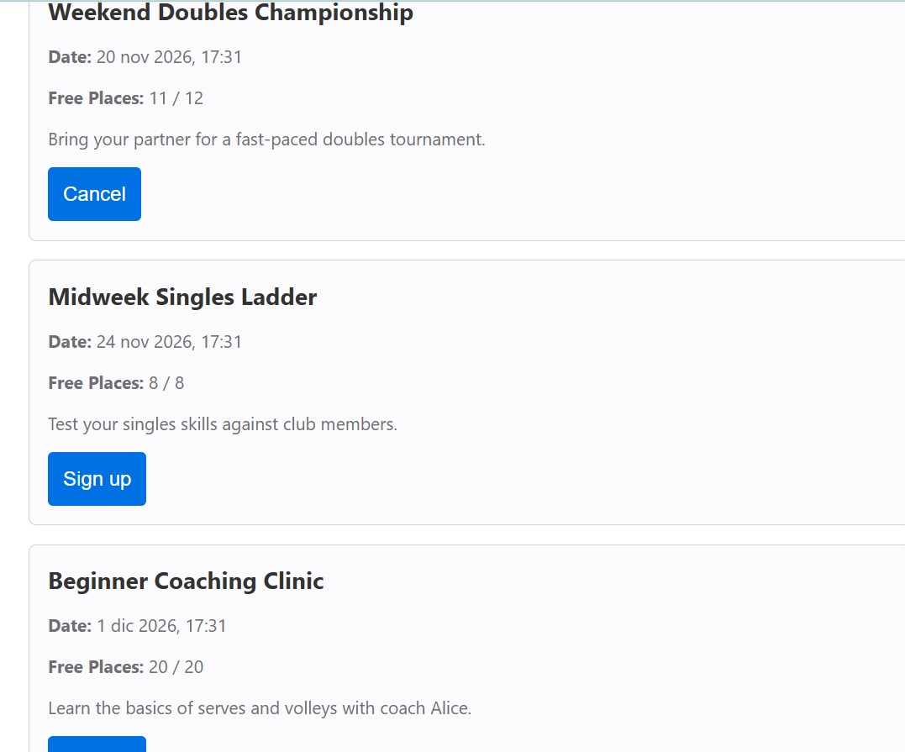
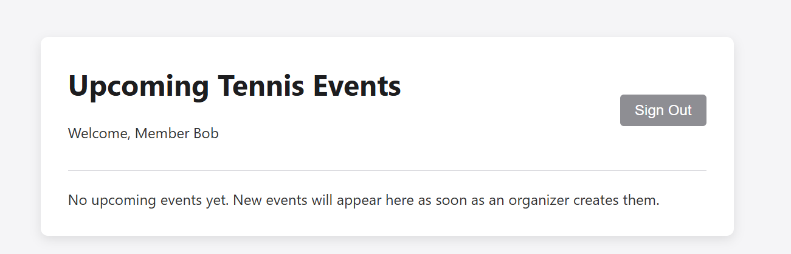
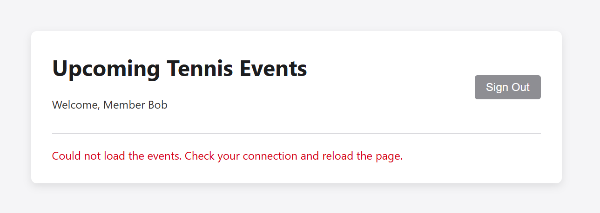

# Readiness report: Club events

## 1. Live URL and how to verify it

https://webdev-erasmus-university-of-alicante.onrender.com

- `/health` returns `{"status":"ok","db":"ok"}`.
- Sign in with `member@club.com` / `secret123` (test account), or with Google.

How I checked: on 18 Nov I ran `curl -s <url>/health` and signed in as Member Bob. On 17 Nov I signed in with my Gmail and a new member appeared in Neon.

## 2. Environment variables

| Name | What it is for | Where it comes from | Secret |
|---|---|---|---|
| `DATABASE_URL` | Neon database | Neon, Connect | yes |
| `SESSION_SECRET` | signs the session cookie | Render, Generate | yes |
| `NODE_ENV` | `production` turns on the Secure cookie | typed in Render | no |
| `PUBLIC_BASE_URL` | Google return address | the Render URL | no |
| `GOOGLE_CLIENT_ID` | Google sign-in | Google Cloud Console | no |
| `GOOGLE_CLIENT_SECRET` | Google sign-in | Google Cloud Console | yes |
| `GEMINI_API_KEY` | the model | Google AI Studio | yes |
| `MODEL_NAME` | `gemini-3.5-flash-lite` | typed in Render | no |
| `PORT` | port of the app | set by Render | no |
| `MCP_TOKEN` | MCP server login | `npm run mcp-token`, only in my codespace | yes |

How I checked: `node src/server.js` with no variables stops with `missing DATABASE_URL, SESSION_SECRET: see .env.example`.

## 3. What happens when things fail

**Database down:** `/health` returns 503 `{"status":"error","db":"down"}`. The sign-in page shows "An error occurred. Please try again." No stack trace.
How I checked: on 18 Nov I ran the Docker image with a wrong `DATABASE_URL` and called `/health` with curl.

**Bad deploy:** Rollback in Render, Events. Render needed 10.6 s; I saw the old version after about 16 s. Users had to sign in again. The rollback turned Auto-Deploy off, so I turned it on again.
How I checked: on 18 Nov I deployed a new heading (c93ae33) and rolled back to b3bcbdd with a stopwatch.

**Failing test:** Auto-Deploy is "After CI Checks Pass", so a red commit is not deployed.
How I checked: on 17 Nov I pushed a failing test (4273ddd). CI was red and Render did not deploy it.

**Garbage:** broken JSON returns 400 `{"error":"The request body is not valid JSON."}`; no sign-in returns 401. Never 500.
How I checked: on 18 Nov I sent both requests with curl to `POST /api/events/1/registrations` on the live site.

**Body that is not JSON:** 415 `{"error":"Send the body as JSON."}` (AC-34). Before 19 Nov a JSON body sent as `text/plain` to `/api/login` gave 500, and a form body even signed you in.
How I checked: on 19 Nov I found it with curl on the live site, wrote the test first (commit `test(AC-34)`, CI red), then the fix (commit `fix(AC-34)`, CI green), and repeated the curl: both requests now get 415.

**Bad id in the address:** `POST /api/events/abc/registrations` gets 404 and `DELETE /api/registrations/abc` gets 403 (AC-38). Before 19 Nov an id that is not a whole number, or one too big for the database, gave 500.
How I checked: on 19 Nov I wrote the test first (commit `test(AC-38)`, CI red), then the fix (commit `fix(AC-38)`, CI green), and repeated the curl on the live site.

## 4. Four states of one screen

Screen: `/events`.

- **Loading:** "Loading events..." 
- **Content:** events with free places and a button. 
- **Empty:** "No upcoming events yet..." 
- **Error:** "Could not load the events. Check your connection and reload the page." 

How I checked: loading and content on the live site with DevTools (Slow 4G). Empty: locally, after deleting all events (the list is the same for every account). Error: locally, I stopped the database and reloaded.

## 5. Request waterfall

Live site, `/events`, Slow 4G, no cache: **5 requests, 4.3 kB, 2.54 s**.

Order: HTML → `style.css` + `events.js` → `/api/me` → `/api/events`. Each step is about 600 ms. `/api/events` waits for `/api/me` but does not need it (gap 5).

How I checked: Edge DevTools, Network, Disable cache, reload.

## 6. Security basics checked

**Secrets:** no real secret in git.
How I checked: `git log --all -- .env` is empty. A search of all history for my real secrets found only a pattern in `checks/lib.mjs` (course template). Secrets that I showed on screen were changed.

**HTTPS:** `http://` redirects to `https://`.
How I checked: curl returned `301` to the https address.

**Write endpoints:** first "are you signed in?" (401), then "is it yours?" or "are you an organizer?" (403).
How I checked: tests for AC-22, AC-23, AC-27 pass. On the live site I signed in as Organizer Alice and tried `DELETE /api/registrations/2` (Member Bob's). I got 403 `NotOwner` and Bob was still signed up.

**Cookie:** `HttpOnly` (JavaScript cannot read it), `Secure` (only over https), `SameSite=Lax` (other sites cannot use it, against CSRF).
How I checked: I read the `set-cookie` header of `POST /api/login` with `curl -i`.

## 7. Known gaps, ranked by risk

1. **No limit on wrong passwords**, and test accounts use a weak password.
   Next step: block for 15 minutes after 10 failures; change the test accounts.
   How I checked: 20 wrong passwords in 12 s, 20 × 401, no 429.
2. **Sessions in memory:** every deploy signs everyone out.
   Next step: sessions in Postgres (`connect-pg-simple`).
   How I checked: after the redeploy and the rollback I had to sign in again.
3. **Slow first visit (free plan):** after 15 minutes with no visits, the first visit shows Render's "waking up" page. Render says it can take about 50 s; I measured about 16 s once.
   Next step: paid plan or a message on the sign-in page.
   How I checked: on 19 Nov I opened the live site after it had slept. The request arrived at 20:35:41, Render showed "Starting the instance" at 20:35:55, and my sign-in page appeared about 2 s later (`docs/evidence/27-render-cold-start-2026-11-19.png`).
   
   
4. **Error messages blame the user's connection** when the server fails.
   Next step: a different message for server errors.
   How I checked: the "database down" tests above.
5. **Two requests one after another** (about +600 ms on Slow 4G).
   Next step: `Promise.all` in `events.js`.
   How I checked: the waterfall in section 5.
6. **The model is often slow.** It often takes about 9 s, close to the 10 s timeout, so sometimes the organizer gets the fallback message. I kept 10 s on purpose: waiting longer is worse for the user, and the fallback exists for this.
   Next step: measure it over more calls and try a faster model or a shorter prompt.
   How I checked: on 19 Nov I called the service three times in a row: 3.4 s, 9.0 s and 9.0 s; later 9.4 s (suggestion) and 10.0 s (fallback). The same afternoon I called five Gemini models directly: most answered 503 (overloaded), the others took 10 to 30 s. So the slowness was the provider, not my code, and changing the model would not help.
7. **`X-Powered-By: Express` header** shows the framework.
   Next step: `app.disable('x-powered-by')`.
   How I checked: it is in every `curl -i` answer.
8. **Organizers cannot delete or edit events yet.** A mistake in an event (wrong date, wrong title) cannot be fixed from the app.
   Next step: Delete and Edit for organizers; deleting an event with sign-ups must be refused (the database already does it with ON DELETE RESTRICT).
   How I checked: there is no button or endpoint to delete or edit an event.
9. **Dates far in the future are accepted.** In the form I could create an event in the year 2222. Month, day and time cannot be absurd, because the browser's date picker does not allow it.
   Next step: refuse dates more than one or two years ahead.
   How I checked: I created an event in 2222 in the form on my local app (`docs/evidence/25-event-in-year-2222-accepted.png`).
10. **Places are only checked from 1 to 500.** The app does not check if the number makes sense for the event (500 places for a coaching clinic is accepted).
   Next step: limits per type of event, decided with the club.
   How I checked: I tried it in the form on my local app.

## 8. Model feature

Organizers get a description of max 80 words. Model: `gemini-3.5-flash-lite`. On /events an organizer sees "Describe a new event": notes, a "Suggest description" button, "Thinking..." while waiting, then the suggestion labelled "Suggestion from the model. Check it before you use it", or the fallback message. Members do not see it, and the server still answers 403 to them.

- **Prompt:** the first real answers had Markdown (`**Details:**`), a placeholder (`[Insert Location]`) and a fact that was not in my notes ("Spaces are limited"). Now the prompt asks for plain text, one paragraph, no placeholders, and only facts from the notes. The model is not deterministic, so the label still tells the organizer to check it.

- **Data that leaves the app:** only the organizer's notes.
- **Cost:** one call = 31 input + 79 output tokens. At $0.30 / $2.50 per million tokens (list price, eesel.ai, 22 July 2026) that is about **$0.00021 per call**.
- **When the key is missing or Google fails:** 200 with "Suggestion not available, write the description yourself", in 0.10 s.

How I checked: I read `usageMetadata` from a real call. On the live site I got a real 60-word answer. Then I deleted `GEMINI_API_KEY` in Render, deployed, called it again and got the fallback message. After that I put the key back.

## 9. MCP

- **Tools:** `list_upcoming_events`, `get_event`, `sign_up_for_event`. They use the same services as the website, so the same rules apply.
- **Who can call them:** only someone with `MCP_TOKEN`. The server acts as the member who owns the token.
- **What a token gives:** the rights of that member, nothing more. The database keeps only a hash of the token.
- **Not deployed:** it runs in my codespace next to the agent. Deploying it would open a second door to the app only for me.

How I checked: the `mcp` CI job is green, `node checks/ex3.mjs` passed 18/18, and a second `sign_up_for_event` for the same event returned `AlreadySignedUp`.
