# UI checklist

<!-- Exercise 4 hands this in. Tick an item only when you have checked it, and replace
     the "how I checked" line with what you actually did. An unticked box is not a
     failure: it is a gap you then write into READINESS.md. A ticked box you cannot
     demonstrate at the defence is worse than an unticked one. -->

"Modern" is not a style. It is a short list of things a user notices when they are
missing: the screen tells you what is happening, you can get through it with a keyboard,
the text is readable, and nothing jumps around while it loads.

## Layout and typography

- [x] **One spacing scale and one type scale.** Sizes come from a small set of design tokens, not from numbers typed where they were needed.
  - how I checked: `public/assets/style.css` starts with a `:root` list of tokens (`--space-1` to `--space-6`, `--text-sm`, `--text-md`, `--text-lg`, colours). Every padding, margin, gap and font size uses `var(...)`. The only numbers left are borders, the shadow and the focus outline.
- [x] **Responsive at 380, 768 and 1280 pixels wide.** No horizontal scrollbar, no text running under another element.
  - how I checked: Edge DevTools, device toolbar (Ctrl+Shift+M), widths 380, 768 and 1280 on `/events`. No horizontal scrollbar and nothing on top of other things. At 380 the title and "Sign Out" go to two lines. Screenshots: `docs/ui/responsive-380.png`, `responsive-768.png`, `responsive-1280.png`.
- [x] **Nothing jumps while the page loads.** Images and cards reserve their space before their content arrives.
  - how I checked: Lighthouse (mobile) on `/events`: Cumulative Layout Shift 0.003 with the tabs (good is below 0.1). After my first UI changes it was 0.346, because the box was centred and moved up when the list arrived. I put the box at the top (`align-self: flex-start`) and it went back to 0.

## The four states, on every screen

A screen that only handles "it worked" is a screen that lies to the user on the day it matters.

- [x] **Loading.** Something tells the user the app is working, within about 100 ms.
  - how I checked: "Loading events..." and "Welcome, Loading..." are in the HTML itself, so they appear with the page, before any request. Seen on the live site with Slow 4G (`docs/ui/events-loading.png`). `/login` loads no data.
- [x] **Empty.** The screen says what this list is for and what to do next, instead of showing nothing.
  - how I checked: locally, after deleting all events: "No upcoming events yet. New events will appear here as soon as an organizer creates them." (`docs/ui/events-empty.png`).
- [x] **Error.** A sentence a person can read. Never a raw JSON body, never a stack trace, never just "Error".
  - how I checked: locally, signed in, then `docker stop club-db` and reload: "Could not load the events. Check your connection and reload the page." (`docs/ui/events-error.png`). Sign-in with the database down: "An error occurred. Please try again." (`docs/ui/login-db-down.png`).
- [x] **Success.** The user can see that what they did took effect, without reloading the page to find out.
  - how I checked: on the live site I clicked Sign up: a green "You are signed up" appears, the button changes to Cancel and the free places go down by one, with no page reload.

## Keyboard and accessibility

- [x] **The main flow works with the keyboard alone.** Sign in, do the core action, sign out, without touching the mouse.
  - how I checked: on the live site, only Tab and Enter: signed in, signed up for an event and cancelled it, and signed out.
- [x] **The focused element is visible.** A `:focus-visible` outline that is not switched off.
  - how I checked: `style.css` has `:focus-visible { outline: 3px solid ... }`. Pressing Tab on `/login` and `/events`, I could always see the blue outline on the current element.
- [x] **Text contrast is at least 4.5:1.** Name the tool you measured with.
  - how I checked: Lighthouse in Edge DevTools. The first run found low contrast (grey Sign Out button and green message) and gave Accessibility 82. I changed the colours and the next run gave Accessibility 100. With the clay court design and the tabs it is still 100.
- [x] **Every input has a label** a screen reader reads, not just placeholder text.
  - how I checked: in `login.html` both inputs are inside a `<label>` ("Email", "Password"). Lighthouse Accessibility 100 includes the check "form elements have associated labels".
- [x] **The page has a correct `<title>` and `lang`.**
  - how I checked: both pages have `<html lang="en">`. Titles: "Sign In - Club Events" and "Upcoming Tennis Events - Club Events".
- [x] **Touch targets are at least 44 pixels.**
  - how I checked: buttons and the Google link have `min-height: var(--touch)` (44px) in `style.css`. In DevTools, the element picker shows the Sign Out button 44 px high.

## The model feature

- [x] **It shows that it is thinking.** A model call is slow and a free service may have been asleep; a frozen button is the worst possible answer.
  - how I checked: signed in as organizer, clicked "Suggest description": "Thinking... this can take a few seconds." appears at once and the button is disabled until the answer comes (often 3 to 9 s).
- [x] **It shows when it failed,** and the rest of the screen still works.
  - how I checked: started the app locally with `GEMINI_API_KEY=` empty and clicked the button: "Suggestion not available, write the description yourself", the button works again and the tabs and events still work (`docs/ui/model-failed.png`).
- [x] **The user can tell the model's suggestion from a fact.** It is labelled as a suggestion, not presented as data the app knows.
  - how I checked: the answer appears in a box with a dashed border and the label "Suggestion from the model. Check it before you use it." (`docs/ui/model-suggestion.png`). It is never saved as event data.

## Decisions

- [x] **Dark mode, or a written decision not to have one.**
  - what I decided and why: no dark mode. The app has two short screens and members use it for a few seconds to sign up. I prefer to spend the time on the known gaps in READINESS.md.

## Evidence

<!-- Screenshots of at least the four states of one screen, and of the model feature
     thinking and failing. A link to them is enough; they do not have to be in the repo. -->

Four states of `/events`:

- 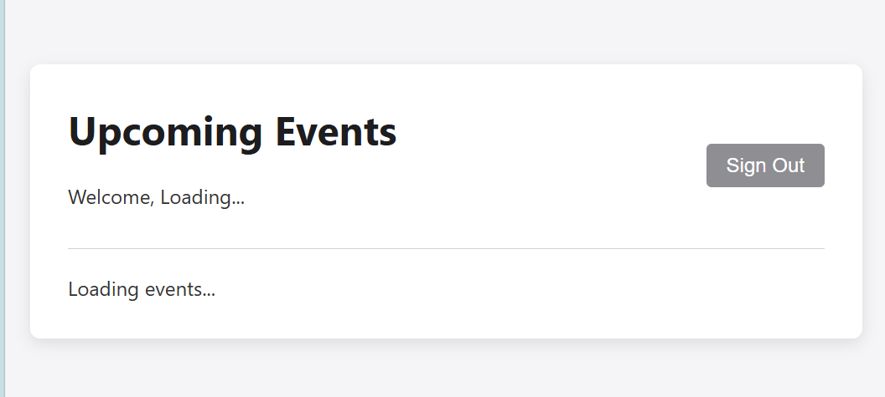
- 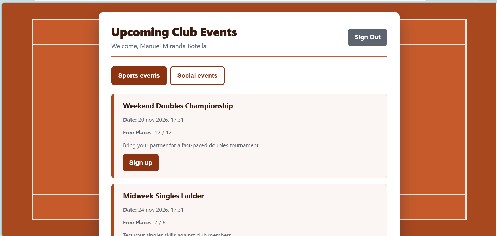
- 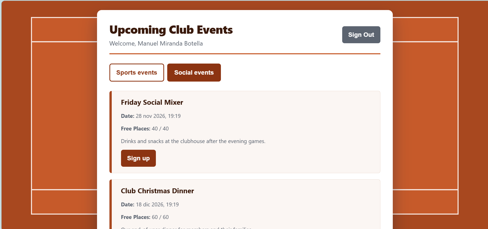
- 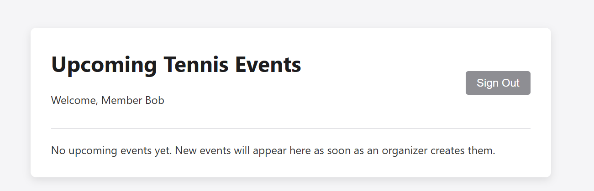
- 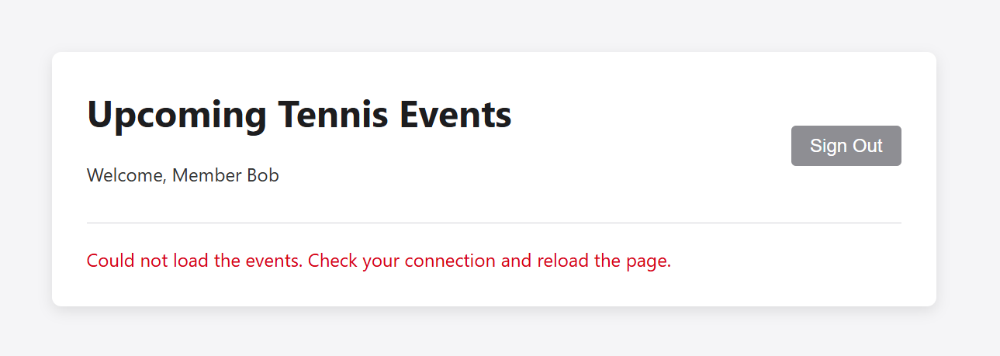

Responsive: 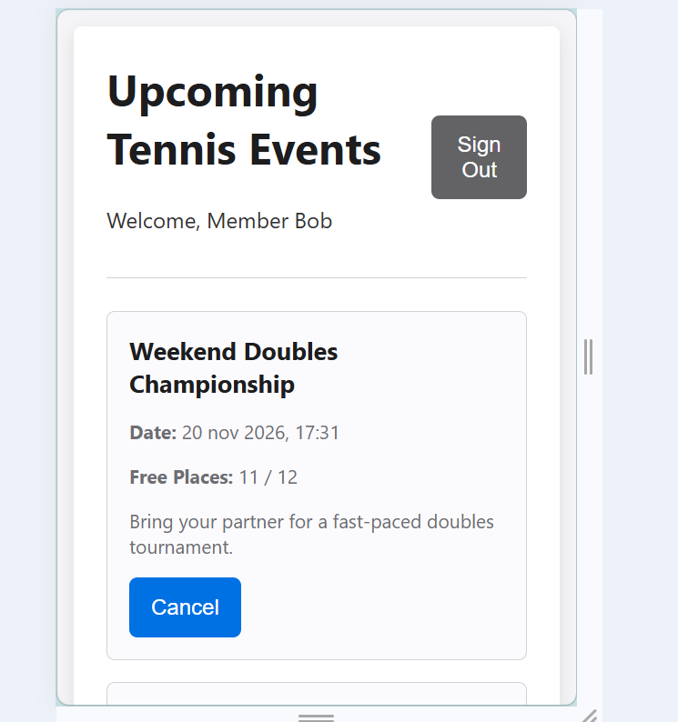 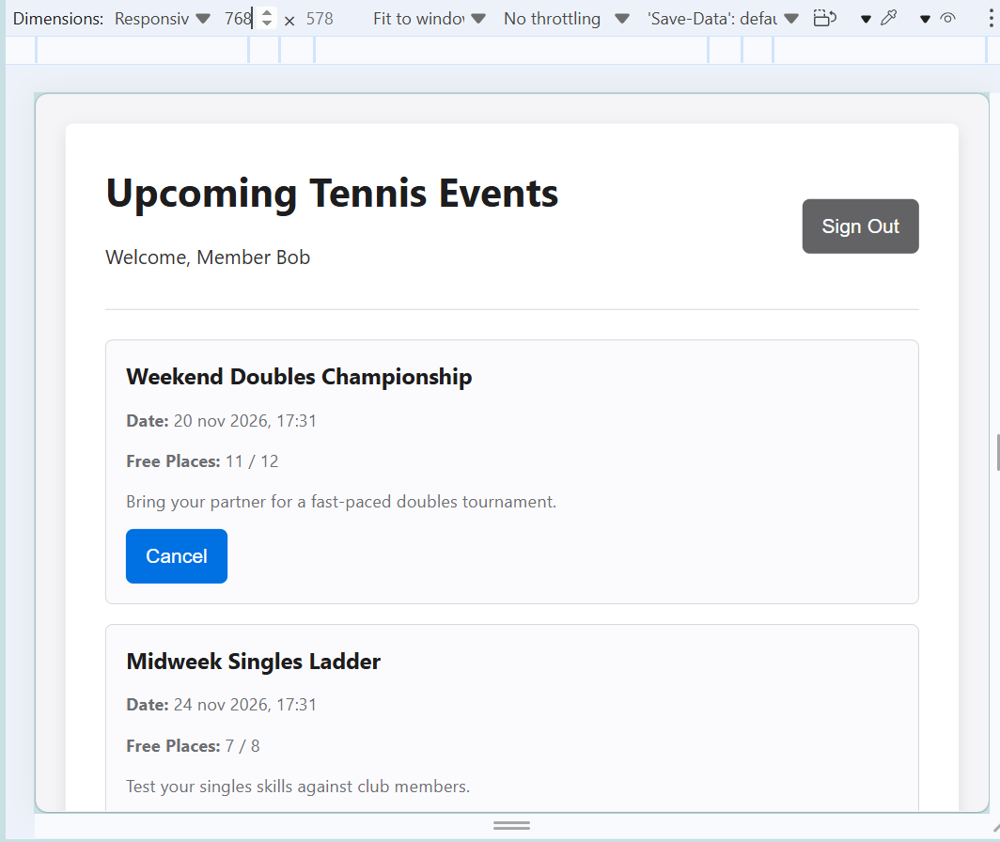 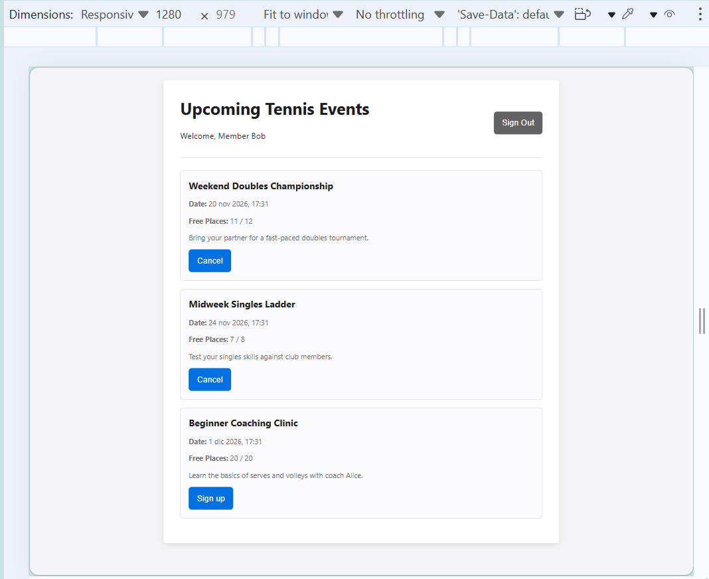

Model feature (organizer):

- 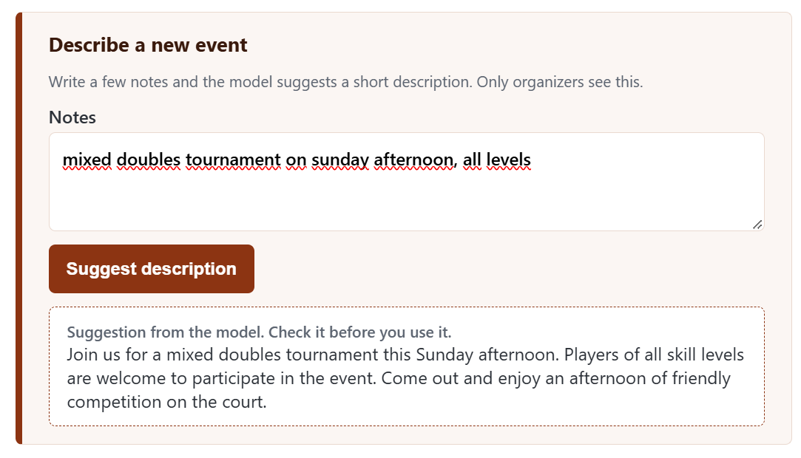
- 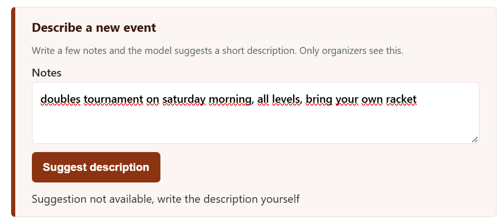
- 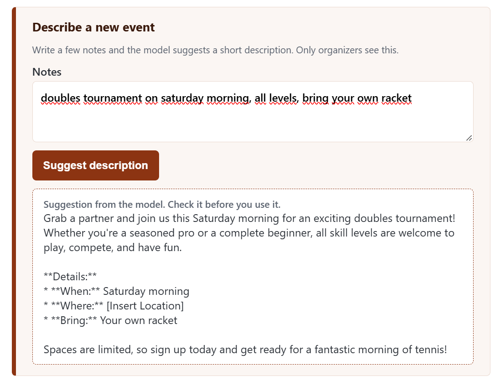
